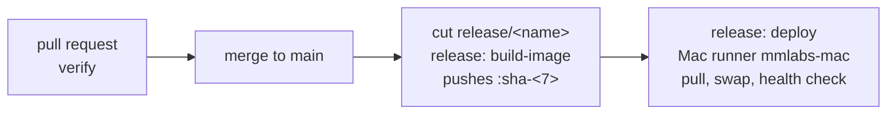

# CI/CD: how mmlabs.online is checked, built and deployed

Modelled on CaleChip's pipeline (`build-image`, `runner-check`, and the `deploy-calechip` draft), but
smaller: there is no deployment repository. A push to a `release/**` branch builds the image and
deploys it on the Mac in the same run. **Where this page and a workflow disagree, the workflow is
right.**



## Workflows

| Workflow | File | Trigger | Runs on | What it does |
|---|---|---|---|---|
| `verify` | `.github/workflows/verify.yml` | pull request to `main` or `release/**` | GitHub-hosted | `build.py`, no unfilled `{{…}}` token, every app and blog page written |
| `release` → `build-image` | `.github/workflows/release.yml` | push to `release/**` | GitHub-hosted | builds the image, smoke-tests `/healthz` and every page, pushes `amd64` + `arm64` as `:sha-<7>` and `:release-<name>` |
| `release` → `deploy` | same file | after `build-image` | **self-hosted Mac, label `mmlabs-mac`** | pulls that digest, replaces the `mmlabs-home` container on port 3000, health-checks it, restores the previous container on failure |
| `runner-check` | `.github/workflows/runner-check.yml` | by hand (`workflow_dispatch`) | Mac | proves the runner picks up jobs, is not root, and reaches Docker |

- **Nothing runs on a push to `main`.** The old `docker.yml` (push to `main` → `:latest`) was
  removed. `:latest` is no longer pushed and is never deployed. The deploy uses only
  `mingming21400/mmlabs-site@sha256:<digest>`, the image that passed the smoke test.
- **No `pull_request` workflow runs on the Mac.** Only a push to a branch of this (private)
  repository can start a job there. Keep it that way: pull request code must never reach the Mac.

## Secrets and settings

Names only. No value belongs in any file.

| Name | Kind | Where | Used by |
|---|---|---|---|
| `DOCKERHUB_USERNAME` | secret | Settings → Secrets and variables → Actions | `build-image` |
| `DOCKERHUB_TOKEN` | secret | same | `build-image`: a Docker Hub access token, read/write |
| `prod` | environment | Settings → Environments | `deploy`. Created on the first run. Add **required reviewers** there if each deploy should wait for approval. |

- The image name is `IMAGE` at the top of `release.yml` (`mingming21400/mmlabs-site`). Its owner must
  be the `DOCKERHUB_USERNAME` account, or `build-image` stops at `secrets present` and says so.
- The Mac needs no GitHub secret. If the Docker Hub repository is **private**, run `docker login`
  once on the Mac as the runner's user; the credential stays in that user's Docker config.

## Mac runner

Done once, by hand, on the Mac that serves mmlabs.online. Each step ends with a **Check**.

1. **Docker runs at login.** Install Docker Desktop (or OrbStack/Colima), turn on *Start when you sign
   in*, and sign in to the Mac.
   **Check:** `docker run --rm hello-world` prints *Hello from Docker!*

2. **The Mac stays awake and comes back after a restart.** A sleeping Mac takes the runner with it.
   ```bash
   sudo pmset -a sleep 0 disksleep 0
   sudo pmset -a autorestart 1   # power back on after a power cut
   ```
   Turn on automatic login for the runner's user (System Settings → Users & Groups). The runner and
   Docker Desktop both start in that user's session.
   **Check:** `pmset -g | grep -E ' sleep|autorestart'` shows `sleep 0` and `autorestart 1`.

3. **Register the runner** for this repository only. On GitHub: *Settings → Actions → Runners →
   New self-hosted runner → macOS*, and pick the architecture of the Mac (`uname -m`: `arm64` or
   `x86_64`). Run the download commands it shows, as your normal user and **not** with `sudo`. Then:
   ```bash
   ./config.sh --url https://github.com/mmlabs-online/landing --token <token from that page> \
     --name mmlabs-mac --labels mmlabs-mac --unattended
   ```
   **Check:** the runner `mmlabs-mac` is listed on that page with the labels `self-hosted`, `macOS`,
   `ARM64` or `X64`, and `mmlabs-mac`.

4. **Run it as a service** so it starts at login with no terminal open:
   ```bash
   ./svc.sh install
   ./svc.sh start
   ./svc.sh status
   ```
   **Check:** `./svc.sh status` says *Started*, and the runner shows **Idle** on GitHub.

5. **Point the tunnel at the container.** cloudflared on the Mac sends `mmlabs.online` to
   `http://localhost:3000`. That is the port the deploy publishes.

6. **Prove it.** Actions → `runner-check` → *Run workflow*.
   **Check:** green, and the log shows your user (not root) and the Docker version. Run it again
   after restarting the Mac.

A container started by hand with the README's `docker run --name mmlabs-home … -p 3000:3000` is
fine: the first deploy replaces it, and keeps it as the fallback until the new one is healthy.

## Cutting a release

1. Make sure what you want to ship is on `main`, and that its pull request's `verify` was green.
2. Cut the branch and push it:
   ```bash
   git switch main && git pull
   git switch -c release/2026-10-28
   git push -u origin release/2026-10-28
   ```
3. Watch Actions → `release`. `build-image` pushes `mingming21400/mmlabs-site:sha-<7>` and
   `:release-2026-10-28`, then `deploy` runs on the Mac. If `prod` has required reviewers, approve it.
4. **Confirm it.** The run's summary ends with `deployed: … is running on <mac> and healthy`.

A fix for the release goes to the same branch (cherry-pick or commit, then push). Each push is a new
build and a new deploy. Branch names: anything under `release/`, e.g. `release/2026-10-28` or
`release/v1.2.0`.

## When a deploy fails

The deploy keeps the previous container stopped (renamed to `mmlabs-home-prev`) until the new one
answers `ok` on `/healthz`. The summary gives one result:

| Result | Meaning | What to do |
|---|---|---|
| `deployed` | the new image is running and healthy | nothing |
| `restored` | the new image failed its health check; the previous one is running again | read the logs of the failed container in the run (*logs of the failed container*), fix, push again |
| `no-previous` | the new image failed and nothing ran before it; **the site is down** | fix the image and push again |
| `restore-failed` | the new image failed, and so did the previous one; **the site is down** | on the Mac: `docker ps -a`, `docker logs mmlabs-home`, then start a known-good image (below) |
| `did-not-complete` | stopped before the swap (Docker not running, pull failed, …) | the running container was not touched; fix the cause and re-run the job |

**Roll back to an earlier release by hand:** find the digest in that release's `build-image`
summary, then on the Mac:

```bash
docker rm -f mmlabs-home
docker run -d --name mmlabs-home --restart unless-stopped -p 3000:3000 mingming21400/mmlabs-site@sha256:<digest>
```

Or open that older `release` run and re-run only its `deploy` job.
