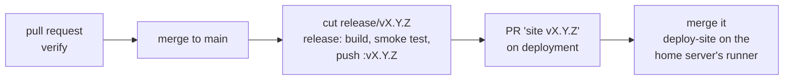

# CI/CD: how mmlabs.online is checked, released and deployed

The same flow as Ricotdin and CaleChip. This repository builds and pushes the image; the
[`mmlabs-online/deployment`](https://github.com/mmlabs-online/deployment) repository decides what runs
on the home server. **Where this page and a workflow disagree, the workflow is right.**



## Workflows

| Workflow | Where | Trigger | What it does |
|---|---|---|---|
| `verify` | this repo, `.github/workflows/verify.yml` | pull request to `main` or `release/**` | `build.py`, no unfilled `{{…}}` token, every app and blog page written |
| `release` | this repo, `.github/workflows/release.yml` | push to `release/**` | builds the image, smoke-tests `/healthz` and every page, pushes `mingming21400/mmlabs-site:vX.Y.Z` (and `:sha-<7>`), opens the pull request `site vX.Y.Z` on the deployment repo |
| `pr-scope` | deployment repo | that pull request | a `release/site-v…` pull request may change only `apps/site/` |
| `deploy-site` | deployment repo | merge to `main` touching `apps/site/**` | on the home server's self-hosted runner: pull the pinned image, `compose up --wait`, restore the previous version if unhealthy, comment the result on the pull request |

- **Nothing deploys from this repository.** Code here only ever runs on GitHub's runners; the home
  server runs only what is merged on the deployment repo.
- **Nothing runs on a push to `main`**, and `:latest` is no longer pushed. The deploy uses only
  `mingming21400/mmlabs-site:vX.Y.Z@sha256:<digest>`, the image that passed the smoke test.

## Secrets

Names only. No value belongs in any file. Settings → Secrets and variables → Actions on **this**
repository:

| Name | Used by | Scope |
|---|---|---|
| `DOCKERHUB_USERNAME` | `release` | the Docker Hub account that owns `mingming21400/mmlabs-site` |
| `DOCKERHUB_TOKEN` | `release` | a Docker Hub access token, read/write |
| `DEPLOY_REPO_TOKEN` | `release` | a **fine-grained** token on `mmlabs-online/deployment` **only**: Contents and Pull requests read/write, nothing else. The same kind Ricotdin and CaleChip use. |

The image name is `IMAGE` at the top of `release.yml`. If `DOCKERHUB_USERNAME` is another account,
`release` stops at `inputs present` and says so.

## Cutting a release

1. What you want to ship is on `main`, and its pull request's `verify` was green.
2. Choose the version. The site runs `v0.2` today (`apps/site/release.env` on the deployment repo),
   so the next one is e.g. `v0.3.0`. A pre-release is `vX.Y.Z-rc.1`.
3. Cut the branch and push it:
   ```bash
   git switch main && git pull
   git switch -c release/v0.3.0
   git push -u origin release/v0.3.0
   ```
   `release/0.3.0` works too. Any other name under `release/` fails at `version` and builds nothing.
4. `release` runs. Its summary gives the image digest and the link to the pull request
   **`site v0.3.0`** on the deployment repo.
5. **Review and merge that pull request.** It changes one file, `apps/site/release.env`. Merging it is
   the deploy.
6. **Confirm it.** `deploy-site` comments `deployed: …` on the merged pull request. Any other comment
   is a case in [When a deploy fails](#when-a-deploy-fails).

**A version is released once.** Pushing a new commit to `release/v0.3.0` after it was released fails
at `already released?`: `:v0.3.0` is never moved. Put the fix on `main` and cut `release/v0.3.1`.
Re-running a failed `release` run for the same commit is fine: it reuses the image it already pushed
and updates the open pull request.

## When a deploy fails

`deploy-site` on the deployment repo handles it, exactly as for CaleChip and Ricotdin:

| Comment | Meaning | What to do |
|---|---|---|
| `deployed` | the new version is running and healthy | nothing |
| `restored` | the new version failed its health check; the previous one is running again and the revert is on the deployment repo's `main` | find out why, fix on `main`, cut the next version |
| `no-previous` | the new version failed and there was nothing to go back to | fix the image and cut the next version |
| `restore-failed` | the new version failed and so did the previous one; **the site is down** | on the server: `docker compose -p site logs`, then deploy a known-good `release.env` by hand (below) |
| `restore-unpushed` | the previous version is running but the revert could not be pushed | push the revert to the deployment repo's `main` by hand |

**Roll back a healthy but wrong release:** on the deployment repo, revert the merged `site vX.Y.Z`
pull request (GitHub's *Revert* button) and merge the revert. `deploy-site` deploys the previous pin
through the same path.

**By hand, when GitHub or the runner is down** (from a checkout of the deployment repo at the
known-good commit):

```bash
docker compose -p site -f apps/site/compose.yml --env-file apps/site/release.env up -d --wait
```

Then merge a revert on the deployment repo so its `main` matches what is running.
